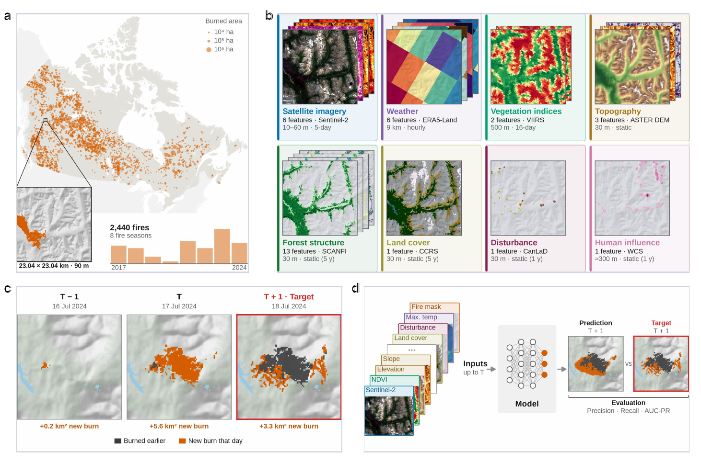

# 🍁 DailyWildfireCAN: Code for Next-Day Wildfire Spread Prediction in Canada

[📄 Paper](https://arxiv.org/abs/2611.14207) · [🌐 Project page](https://dailywildfirecan.github.io) · [🗂️ Dataset](https://huggingface.co/datasets/DailyWildfireCAN/DailyWildfireCAN) · [🏆 Benchmark checkpoints](https://huggingface.co/DailyWildfireCAN/DailyWildfireCAN-Benchmark)

This repository contains the code to **build the dataset** (`data_preparation/`, `samples_generation/`) and to **train and evaluate the benchmark models** (`src/`, `main.py`). The dataset content, splits, sample format, channel order and licenses are documented on the [dataset card](https://huggingface.co/datasets/DailyWildfireCAN/DailyWildfireCAN). Trained checkpoints and results are on the [benchmark card](https://huggingface.co/DailyWildfireCAN/DailyWildfireCAN-Benchmark).



## Citation

```bibtex
@article{dailywildfirecan,
  title={DailyWildfireCAN: A Dataset and Benchmark for Next-Day Wildfire Spread Prediction in Canada},
  author={Ettahri, Mahacine and Abdelwahed, Hager Radi and Olutayo, Toluwaleke and Aloise, Daniel and Caron, Ga{\"e}tan Marceau},
  journal={arXiv preprint arXiv:2611.14207},
  year={2026}
}
```

## Setup

```bash
git clone https://github.com/hagerradi/DailyWildFireCAN && cd DailyWildFireCAN
python -m venv env_wildfires_spread
source env_wildfires_spread/bin/activate   # Windows: env_wildfires_spread\Scripts\activate
pip install -r requirements.txt
```

Edit `configs/settings.py` and set absolute paths for:

* `PROJECT_FOLDER`: this repository.
* `DATA_FOLDER`: raw downloaded sources (see [`data_preparation/README.md`](data_preparation/README.md)).
* `OUTPUT_FOLDER`: generated data. Its subfolders are created automatically the first time any script runs.

## 📂 Data

### Option 1 (recommended): pre-built samples

Download `mono_temporal_samples/` or `multi_temporal_samples/` from the [dataset repository](https://huggingface.co/datasets/DailyWildfireCAN/DailyWildfireCAN) (the card lists sizes and download snippets) and extract each `.tar` into the sample folder from `configs/settings.py`: `SAMPLE_FOLDER` for mono-temporal, `TIMESERIES_SAMPLE_FOLDER` for multi-temporal (the `_ADVANCED` variants are used by the `*_advanced` scripts):

```text
Samples/
├── train/
├── val/
├── test_easy/
├── test_medium/
└── test_hard/
```

The normalization statistics (`training_stats_*.json`) are in the same repository.

### Option 2: generate samples from the raw data

Download `raw_data/` from the dataset repository and place it as follows:

| Raw data | Destination (`configs/settings.py`) |
|---|---|
| `fire_data/*.h5` | `H5_OUTPUT_FOLDER` |
| `metadata_fires_per_year/*.json` | `METADATA_FOLDER` |
| `fire_growth_points_CFSDS/` (one `Firegrowth_pts_v1_1_<year>/` folder per year) | `BASE_FOLDER` |

Then run from the project root:

```bash
python -m samples_generation.data_generator_main --config configs/default.yaml --type simple      # mono-temporal
python -m samples_generation.data_generator_main --config configs/default.yaml --type timeseries  # multi-temporal
```

Feature selection, target years and sequence length (default 3) are set in `samples_generation/samples_configs/samples_settings.py`. The splitting logic, spatial-leakage guarantees and `.npz` keys are described on the dataset card. Normalization statistics are computed on the training split only and saved as a `.json` next to the samples.

To rebuild the raw `.h5` files from the original sources (ERA5-Land, SCANFI, ASTER, Sentinel-2, etc.), see [`data_preparation/README.md`](data_preparation/README.md).

## 🤖 Modeling


Pre-trained checkpoints and AUC-PR results for these models are on the [benchmark card](https://huggingface.co/DailyWildfireCAN/DailyWildfireCAN-Benchmark).

### Configuration (`configs/default.yaml`)
All training hyperparameters, hardware settings, and logging preferences are centralized in `configs/default.yaml`. Before training, you can adjust this file to suit your needs.

### Model Selection & Customization
Multiple model architectures are implemented in the `src/models/` directory to handle different temporal and spatial requirements. 

To switch between architectures (which will automatically configure the corresponding dataloaders, such as swapping from single-day static prediction to a 3-day sliding window), open your `configs/default.yaml` and update the `architecture` parameter under the `model` section to one of the following options:

#### Mono-Temporal Models:
1. **Standard UNet** (`architecture: 'unet'`):
   The baseline spatial U-Net model.
2. **U-Net with time-gap encoding** (`architecture: 'unet_time_gap'`): 
   A U-Net that explicitly encodes the satellite age (the time gap in days between the fire event and the satellite acquisition).
3. **Attention UNet** (`architecture: 'unet_attention'`): 
   A U-Net utilizing attention gates in the skip connections to help the model focus on the most critical spatial features and suppress irrelevant background noise.
4. **UNet-SegFormer** (`architecture: 'unet_segformer'`): 
   A hybrid vision-transformer architecture that replaces the standard CNN encoder with SegFormer's Mix Vision Transformer (MiT), paired with a standard U-Net decoder for heavy pixel-level accuracy. 
5. **Swin-U-Net** (`architecture: 'asufm'`): 
   A U-shaped encoder-decoder architecture with skip connection, where convolutional blocks are replaced with Swin Transformers blocks (Li & Rad, 2024).
6. **U-Mamba** (`architecture: 'umamba'`): 
   An encoder-decoder architecture that incorporates Mamba-based state space blocks alongside traditional convolutions for feature extraction (Ma et al., 2024).
7. **Geospatial Foundation Models** (`architecture: 'unet_olmo_offline'` and `architecture: 'dual_dinov3'`): 
   Two recent foundation models, OlmoEarth (Herzog et al., 2026) and DINOv3 (Siméoni et al., 2025), using their pre-trained representations for the next-day wildfire spread prediction task.

#### Multi-Temporal Models:
1. **Spatiotemporal UNet** (`architecture: 'unet_convlstm'`): 
   A U-Net featuring a **ConvLSTM** bottleneck for recurrent time-series processing (e.g., 3-day sliding window forecasting).
2. **UTAE** (`architecture: 'utae'`):
   A temporal attention encoder-decoder baseline adapted from the ICCV 2021 U-TAE model for satellite image time series. This baseline uses the time-series offline samples from `Timeseries_Samples/`, and the generator now stores sequence positions for the temporal attention encoder when you regenerate those samples.
3. **Simpler yet better video prediction (SimVPv2)** (`architecture: 'simvpv2_spatiotemporal'`): 
   Originally designed for video prediction, SimVPv2 (Tan et al., 2025) is utilized here as a purely convolutional baseline for spatio-temporal spread forecasting.
4. **Video Swin-U-Net** (`architecture: 'video_swin_unet'`): 
   Extended Swin-U-Net by incorporating 3D Video Swin Transformers blocks (Srivastava et al., 2026) to capture joint spatial and temporal dynamics across 3-day sequences.
5. **A Multi-Modal Architecture** (`architecture: 'frp'`): 
   A CNN-based multibranch architecture inspired by (Dong et al., 2024), with separate branches for daily weather variables, fire progression sequences, and static features such topography and land cover, followed by late fusion.

#### References
   Li, B. S., & Rad, R. (2024, June). Wildfire spread prediction in North America using satellite imagery and vision transformer. In *2024 IEEE Conference on Artificial Intelligence (CAI)* (pp. 1536–1541). IEEE.

   Ma, J., Li, F., & Wang, B. (2024). U-mamba: Enhancing long-range dependency for biomedical image segmentation. arXiv preprint arXiv:2401.04722.

   Herzog, H., Bastani, F., Zhang, Y., Tseng, G., Redmon, J., Sablon, H., ... & Beukema, P. (2026). Olmoearth: Stable latent image modeling for multimodal earth observation. In Proceedings of the IEEE/CVF Conference on Computer Vision and Pattern Recognition (pp. 34806-34817).

   Siméoni, O., Vo, H. V., Seitzer, M., Baldassarre, F., Oquab, M., Jose, C., ... & Bojanowski, P. (2025). Dinov3. arXiv preprint arXiv:2508.10104.

   Tan, C., Gao, Z., Li, S., & Li, S. Z. (2025). SimVPv2: Towards simple yet powerful spatiotemporal predictive learning. IEEE Transactions on Multimedia, 27, 5170-5184.

   Srivastava, M., Saha, E., & Wang, H. (2026). Spatio-Temporal Wildfire Spread Prediction in Canada using a Video Swin-Hybrid-U-Net and Satellite Imagery. arXiv preprint arXiv:2606.20693.

   Dong, Z., Zhao, F., Wang, G., Tian, Y., & Li, H. (2024). A deep learning framework: Predicting fire radiative power from the combination of polar-orbiting and geostationary satellite data during wildfire spread. IEEE Journal of Selected Topics in Applied Earth Observations and Remote Sensing, 17, 10827-10841.

### Training the Model
The main entry point for the training pipeline is `main.py`, located at the root of the project. 

To run the training loop locally:
```bash
cd /path/to/your/PROJECT_FOLDER/

python -m main --config configs/default.yaml
```

**Key Training Features:**
* **Custom Loss:** Automatically initializes a custom `CombinedLoss` (Focal + Dice) to handle the extreme class imbalance of wildfire pixels.
* **Automatic Checkpointing:** The `Trainer` monitors the Validation IoU. Whenever the model improves, it automatically overwrites and saves `best_checkpoint.pt` to your configured `checkpoint_dir`.
* **Comet.ml Integration:** If `enabled: true` in your config, the pipeline will automatically log learning rates, loss curves, and epoch-by-epoch evaluation metrics directly to your Comet dashboard. It also uploads visual grid predictions at the end of epochs so you can watch the model learn.

### Automatic Evaluation (Testing)
At the end of the `train` loop, `main.py` automatically looks for the `best_checkpoint.pt` generated during training. 

If found, it initiates the `test()` protocol on the holdout test split. This step computes the final metrics. Furthermore, it uploads high-resolution visual predictions (Previous Fire Mask, Ground Truth, Model Prediction) to CometML for your final visual analysis.

### Global Evaluation (Optional)
You can run a global evaluation to test all your models at once. This script evaluates every model across its multiple runs and outputs a consolidated CSV file containing all the grouped metrics.

Run the following command from your project root:
```bash
cd /path/to/your/PROJECT_FOLDER/
python -m src.evaluate --config configs/default.yaml

```

> **⚠️ Note:** the released [benchmark checkpoints](https://huggingface.co/DailyWildfireCAN/DailyWildfireCAN-Benchmark) are named `checkpoints_<model>_run_<N>` and are grouped in folders such as `unet_with_time_gap`. The script accepts both `run<N>` and `run_<N>`, but `<model>` must be the `architecture` value (e.g. `unet_time_gap`), so move the checkpoint folders next to each other in the project root.
>
> **Directory Structure:** For the script to locate your weights, the files must be named `best_checkpoint.pt` and organized in directories following the `checkpoints_<modelName>_run<N>` naming convention.
> For example, a UNet evaluated across three runs should look like this:
> ```text
> 📁 PROJECT_FOLDER/
>  ├── 📁 checkpoints_unet_run1/
>  │    └── 📄 best_checkpoint.pt
>  ├── 📁 checkpoints_unet_run2/
>  │    └── 📄 best_checkpoint.pt
>  └── 📁 checkpoints_unet_run3/
>       └── 📄 best_checkpoint.pt
> 
> ```

### Logistic Regression Baseline

This repository also includes an additive classical logistic-regression baseline. It is separate from the PyTorch trainer, reads the precomputed simple samples from `SAMPLE_FOLDER/{train,val,test}`, ignores `delta_t`, extracts a configurable spatial patch around each pixel, and trains `sklearn.linear_model.SGDClassifier(loss="log_loss")`.

Following the approah in Next Day Wildfire Spread [Huot et al], the baseline performs search over the no-fire class-weight multiplier `W` configured in `training.w_values`. The number of SGD epochs is a fixed config input (`training.epochs`) and is not part of the hyperparameter search. The selected model is the one with the highest validation AUC-PR.

```bash
python -m logistic_regression_main --config configs/logistic_regression.yaml
```

For a quick wiring check:

```bash
python -m logistic_regression_main --config configs/logistic_regression_smoke.yaml
```

On a SLURM cluster:

```bash
sbatch slurm_logistic_regression.sbatch
```

Set `WILDFIRE_SAMPLE_FOLDER=/path/to/Samples` to avoid editing `configs/settings.py`, or set `data.sample_folder` directly in the logistic-regression config. Outputs include `w_sweep_metrics.csv/json`, `final_metrics.json`, `model.joblib`, `scaler.joblib`, and the feature manifest. Reported metrics include `auc_pr`, `average_precision` (AP), IoU, Dice/F1, precision, recall, and accuracy.

## License

The code in this repository is released under the [Creative Commons Attribution-NonCommercial 4.0 International (CC BY-NC 4.0)](LICENSE) license. The [dataset](https://huggingface.co/datasets/DailyWildfireCAN/DailyWildfireCAN) is released under CC BY-NC-SA 4.0 and includes third-party data subject to their own licenses (see the dataset card).

## Contact

For inquiries, contact Mahacine Ettahri (mahacine.ettahri@etud.polymtl.ca) or Hager Radi (hager.radi@mila.quebec).
